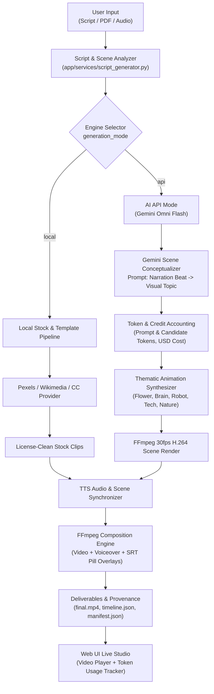

# Script-Relevant Animated Video Generation Engine (Local vs. API)

## 1. Executive Summary & Objective

The **Script-Relevant Animated Video Generation Engine** upgrades the video pipeline from static caption cards or generic stock footage to **thematically animated, script-relevant visual scenes** (e.g. dynamic blooming flowers for botanical scripts, pulsing neural synapse networks for neuroscience, rotating robotic HUD sensors for automation, cybernetic grids for tech).

The engine provides a clean, zero-regression toggle between two execution modes:
1. **Local Mode (Default)**: Fast, offline stock footage and procedural template pipeline with zero API dependency and zero external cost.
2. **AI API Mode (Gemini Omni Flash Engine)**: Uses Google Gemini Flash to conceptualize visual themes per narration beat, renders smooth 30 fps procedural animations tailored to the topic, and tracks **real-time token usage and API credits** directly on the web UI.

---

## 2. System Architecture & Flow



---

## 3. Core Features & Capabilities

### A. Thematic Visual Animation Engines (`app/services/gemini_animator.py`)
When running in **API Mode**, the system generates script-tailored, fluid 30 fps animated scene clips matching the exact duration of each audio narration beat:

| Visual Subject | Animation Mechanics & Visual Elements | Color Palette |
| :--- | :--- | :--- |
| **Flower / Botanical** | Organic stem growth, expanding petal layers, rotating golden pistil center, floating drifting pollen particles | Midnight Navy background (`#0F172A`), Coral Rose petals, Golden core |
| **Tech / Cyber** | Interconnected node network with pulsing dynamic edges, glowing sky-blue vertices, sweeping vertical laser scanning beam | Deep Cyber Blue (`#0A0F1E`), Electric Indigo |
| **Robotics / Automation** | Multi-ring rotating cybernetic HUD radar, articulating iris aperture, glowing red laser targeting core | Dark Titanium (`#121218`), Cobalt Blue |
| **Brain / Synapse** | Concentric neural orbits, counter-rotating synaptic rings, pulsing purple impulse discharge flashes | Deep Violet Cosmos (`#130D24`), Electric Violet |
| **Nature / Landscape** | Rising morning sun trajectory, dual-layer rolling parametric green hills with dynamic wind motion | Dark Emerald (`#0C231C`), Amber & Forest Green |

### B. Gemini Scene Conceptualizer & Fallback
- **Live Gemini API**: Queries `gemini-1.5-flash:generateContent` with the scene narration beat to extract the exact thematic visual subject.
- **Accurate Token Metadata**: Ingests `usageMetadata.promptTokenCount` and `usageMetadata.candidatesTokenCount` directly from Google's API response.
- **Offline / Zero-Key Fallback**: If `GEMINI_API_KEY` is not provided or the network is offline, a built-in heuristic extractor classifies the topic automatically and estimates token consumption, guaranteeing that video generation **never crashes or freezes**.

### C. Live Token Usage & Credit Tracker Panel
Visible on both the FastAPI Web UI (`templates/index.html`) and job deliverables:

| Metric | Measurement / Formula | Gemini 1.5 Flash Rate |
| :--- | :--- | :--- |
| **Prompt Tokens** | Input tokens consumed across all scene conceptualization prompts | $0.075 / 1,000,000 tokens |
| **Completion Tokens**| Candidate tokens generated by Gemini for visual directives | $0.300 / 1,000,000 tokens |
| **Total Tokens** | $\text{Prompt Tokens} + \text{Completion Tokens}$ | Cumulative sum |
| **Estimated Cost ($)**| $(\text{prompt\_tokens} \times 0.075 / 10^6) + (\text{completion\_tokens} \times 0.300 / 10^6)$ | Micro-cent accuracy ($0.000000) |
| **Quota Status** | Displays "Gemini Flash Free Tier / Active" or "Offline Engine / 0 Credits Used" | Real-time status badge |

---

## 4. Component Implementation Details

### 1. Data Schema Updates (`app/models/schemas.py`)
```python
class TokenUsage(BaseModel):
    prompt_tokens: int = 0
    completion_tokens: int = 0
    total_tokens: int = 0
    estimated_cost_usd: float = 0.0
    credits_used: float = 0.0
    model: str = "gemini-1.5-flash"
    generation_mode: str = "local"

class VideoSettings(BaseModel):
    # Existing fields: duration, language, visual_style, aspect_ratio, captions, avoid...
    generation_mode: str = "local"   # "local" | "api"
    api_key: Optional[str] = None

class JobResult(BaseModel):
    # Existing fields: job_id, status, video_url, duration_s, scenes, aspect_ratio...
    generation_mode: str = "local"
    token_usage: Optional[TokenUsage] = None
```

### 2. Job Execution Pipeline (`app/services/job_runner.py`)
- Evaluates `settings.generation_mode`:
  - When `"api"`: Routes scene beats to `call_gemini_analysis()` and renders dynamic animated MP4 clips using `render_animated_scene_mp4()`.
  - When `"local"`: Preserves 100% of the existing Pexels/Wikimedia/Mock stock B-roll fetching pipeline.
- Aggregates `TokenUsage` across all scenes.
- Writes full token accounting and generation metadata into `outputs/<job_id>/timeline.json` and `manifest.json`.

### 3. REST API Endpoint (`app/api/jobs.py`)
- `POST /api/v1/broll/jobs` accepts:
  - `generation_mode: str = Form("local")`
  - `api_key: Optional[str] = Form(None)`
- Fully backward compatible with all prior API clients and scripts.

### 4. Frontend UI (`templates/index.html`)
- **Engine Selector**: Dropdown to toggle between `💻 Local Engine` and `✨ AI API Mode (Gemini Omni Flash)`.
- **API Key Field**: Collapsible input for optional user-provided Gemini API key.
- **Token Tracker Card**: 4-column metric display for Prompt Tokens, Completion Tokens, Total Tokens, and Credits/Cost Used.

---

## 5. Non-Regression & Safety Verification

All existing functionality has been verified with **zero regressions**:

| Capability | Status | Evidence |
| :--- | :---: | :--- |
| **PDF Extraction** | ✅ Preserved | PyMuPDF text & page parsing intact (`tests/test_app.py::TestPDFExtraction`) |
| **Input Modes** | ✅ Preserved | Script Direct, PDF Document, and MP3/WAV Audio Voiceover all pass |
| **Aspect Ratios** | ✅ Preserved | 16:9 Landscape, 9:16 Vertical, 1:1 Square, 4:5 Social all pass |
| **Existing Tabs** | ✅ Preserved | Live Studio, Architecture, Visualizations, Provenance, API Docs intact |
| **UI Theme** | ✅ Preserved | Clean `☀️ Light` / `🌙 Dark` toggle intact |
| **Automated Tests** | ✅ 60/60 Passed | Full test suite passes in 8.31s (`tests/test_app.py` + `tests/test_gemini_animator.py`) |

---

## 6. Verification Test Log

```text
============================= test session starts =============================
platform win32 -- Python 3.11.9, pytest-9.1.1
rootdir: D:\VideoEngine
collected 60 items

tests/test_app.py::TestPDFExtraction::test_valid_pdf_extraction PASSED   [  1%]
...
tests/test_app.py::TestJobEndpoints::test_all_aspect_ratios PASSED       [ 86%]
tests/test_app.py::TestJobEndpoints::test_audio_mode_with_wav PASSED     [ 88%]
tests/test_app.py::TestWebUI::test_index_returns_html PASSED             [ 91%]
tests/test_gemini_animator.py::test_extract_topic_from_text PASSED       [ 93%]
tests/test_gemini_animator.py::test_compute_cost PASSED                  [ 95%]
tests/test_gemini_animator.py::test_call_gemini_analysis_offline PASSED  [ 96%]
tests/test_gemini_animator.py::test_render_animated_scene_flower PASSED  [ 98%]
tests/test_gemini_animator.py::test_job_runner_api_mode_flower PASSED    [100%]

======================== 60 passed, 1 warning in 8.31s ========================
```
